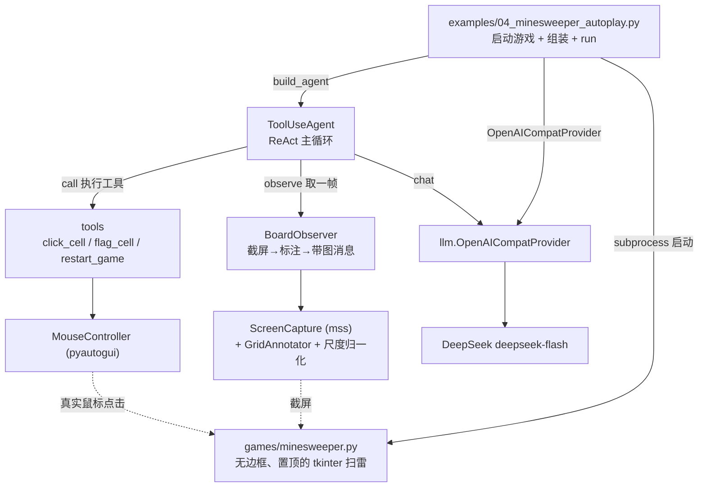
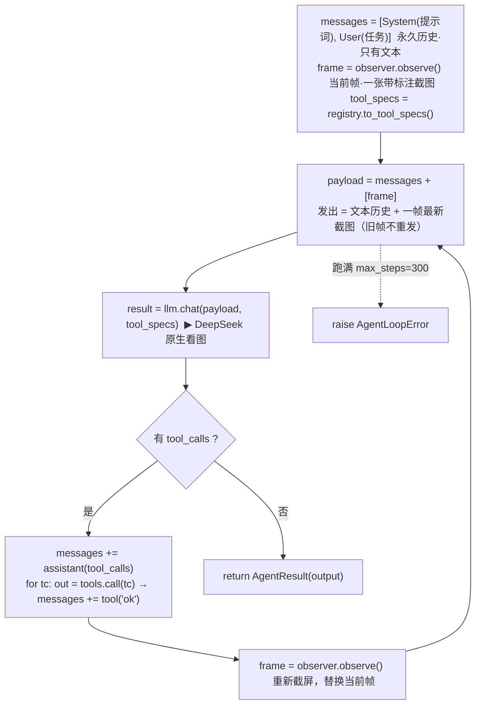
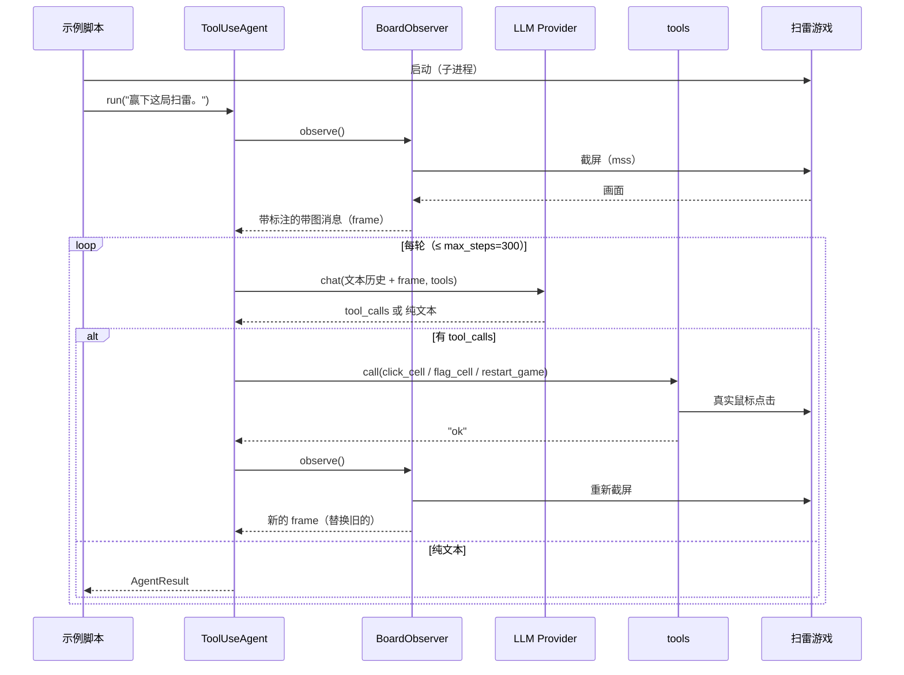

# 扫雷视觉 Agent 调用流程

> 梳理 `examples/04_minesweeper_autoplay.py` 从启动到通关的完整调用脉络。
> 每条链路都对应仓库里的实际源码，括号内为文件位置。

## 1. 组件全景（谁调用谁）



纯文本版：

```
┌─────────────────────── examples/04_minesweeper_autoplay.py ────────────────────────┐
│ ① enable_dpi_awareness()                    ④ llm  = OpenAICompatProvider(settings)│
│ ② subprocess.Popen(games/minesweeper.py)    ⑤ agent = build_agent(config, llm)     │
│ ③ config = board_config()                   ⑥ await agent.run("赢下这局扫雷。")      │
└───────────────┬────────────────────────────────────────────────────┬──────────────┘
                │ 组装                                                │ 启动（子进程）
                ▼                                                    ▼
      ┌────────────────────┐                              ┌───────────────────────────┐
      │ ToolUseAgent        │◀──── observe() 取一帧 ───────│ BoardObserver             │
      │  ReAct 主循环        │                              │  截屏 → 标注 → 带图消息     │
      └──┬──────────────┬──┘                              └──────────┬────────────────┘
         │ chat()       │ call()                                     │ grab()
         ▼              ▼                                            ▼
 ┌───────────────┐ ┌──────────────────┐                    ┌───────────────────────┐
 │ llm           │ │ tools            │                    │ ScreenCapture (mss)   │
 │ OpenAICompat  │ │  click_cell      │                    │   + GridAnnotator     │
 │  Provider     │ │  flag_cell       │                    │   + 尺度归一化         │
 │ (日志+图片落盘)│ │  restart_game    │                    └───────────────────────┘
 └───────┬───────┘ └────────┬─────────┘
         │                  │
         ▼                  ▼
   DeepSeek API     MouseController (pyautogui)
   deepseek-flash    真·移动鼠标 + 点击  ──────▶  ┌──────────────────────┐
                                                 │ games/minesweeper.py │
                                                 │ 无边框/置顶 tkinter 扫雷│
                                                 └──────────────────────┘
```

## 2. 主循环（`ToolUseAgent.run`）



纯文本版：

```
 messages = [ System(扫雷专家提示词), User("赢下这局扫雷。") ]   ← 永久历史：只有文本
 frame    = observer.observe()                                 ← 当前帧：1 张带标注截图
 tools    = registry.to_tool_specs()                           ← 3 个工具的 JSON Schema

 ┌─ for index in range(max_steps=300) ──────────────────────────────────────────────┐
 │   payload = messages + [frame]        ★ 发出去 = 完整文本历史 + 一帧最新截图       │
 │   result  = llm.chat(payload, tools)  ─────────────▶ DeepSeek（原生看图）          │
 │                                                                                  │
 │   ┌── A：有 tool_calls ──────────────────────────────────────────────────────┐    │
 │   │  messages += assistant(tool_calls)                                       │    │
 │   │  for tc in tool_calls:                                                   │    │
 │   │      out = tools.call(tc.name, tc.arguments)   ← 真点鼠标                  │    │
 │   │      messages += Message.tool(tc.id, out="ok")                           │    │
 │   │  frame = observer.observe()    ★ 重新截屏，替换当前帧（旧帧丢弃）           │    │
 │   │  continue                                                                 │    │
 │   └──────────────────────────────────────────────────────────────────────────┘    │
 │                                                                                  │
 │   └── B：纯文本 ──▶ return AgentResult(output)   ← 结束                            │
 └──────────────────────────────────────────────────────────────────────────────────┘
```

**关键点**：`frame` **不进** `messages`。发给模型的永远是「文本历史 + 一帧最新图」，请求体不随轮数膨胀。

## 3. 一轮的时序



## 4. 两条子链路：看 / 做

```
【看】observer.observe()  —— 生产一帧给模型的图
  ScreenCapture.grab()
      │  · scale = mss物理像素 / pyautogui逻辑点（首次探测并缓存）
      │  · region 来自 board_config()：棋盘外扩 左24 / 上20 像素
      ▼  PIL.Image（与鼠标坐标系 1:1）
  GridAnnotator.draw()
      │  · 画红色网格线（格子边界）
      │  · 画蓝色 1 基行列号（棋盘左侧/顶部，靠那 24/20 的边距才落在图内）
      ▼
  下采样（max_px=1300） → 编码 PNG → base64 data URL
      ▼
  Message.user_with_image(caption, png, detail="high")   ← 这就是 frame

【做】tools.call(name, args)  —— 把一个动作落成真实鼠标事件
  click_cell(row,col) → BoardGeometry.cell_center → MouseController.click(x, y, button="left")
  flag_cell(row,col)  → cell_center → MouseController.shift_click(x, y)   ← 按 Shift 再左键（macOS 收不到右键）
  restart_game()      → 点重开按钮 / 按键
      ▼
  pyautogui 发事件 → 扫雷窗口（无边框、置顶）响应
      ▼
  返回 "ok"（不回报坐标细节，让模型看下一帧截图自己判断）
```

## 5. 一次 LLM 请求的组装与落盘

```
 messages(文本历史) + [frame(截图)]        tools(3 个 schema)
        └────────────────┬───────────────────────┘
                         ▼
              openai_compat.chat()
                         │
        ┌────────────────┼──────────────────────────┐
        ▼                                           ▼
 写 log/llm.log（始终 DEBUG，不受 LOG_LEVEL 影响）   POST https://api.deepseek.com/chat/completions
  · 请求：messages + tools 的 JSON                  · 图片以 base64 data URL 内联在 messages 里
  · 内联图片被抽出，落盘到
    log/pic/<时间戳>_<内容哈希>.png（同图去重），
    日志里只留文件路径引用
        │
        ▼
 返回 ChatResult(content=文本?, tool_calls=[...]?)
```

## 6. 关键设计点

| 点 | 说明 |
|---|---|
| **观察帧不进历史** | 每次请求临时附加一帧最新截图，历史只留文本（任务 / assistant tool_calls / tool 结果），请求体不随轮数膨胀 |
| **工具返回 `ok`** | 不回报"翻了哪格 / 点了哪个坐标"，让模型依据最新截图判断结果 |
| **插旗用 Shift+左键** | macOS 上 pyautogui 合成的右键/中键触发不了 tkinter 事件，只有左键能 |
| **坐标精确** | 1 基行列号 → `origin + (n-1)*cell + cell//2`，整数精确换算；`scale` 归一化保证截图像素与鼠标坐标 1:1 |
| **行列标尺可见** | 截屏区域在棋盘左/上留边距，`GridAnnotator` 的行列号才落在图内 |
| **日志** | `log/llm.log` 始终记录请求/回包；`log/pic/*.png` 存请求里的截图 |

## 7. 对应源码

| 环节 | 文件 |
|---|---|
| 入口 / 组装 | `examples/04_minesweeper_autoplay.py` |
| 目标游戏 | `games/minesweeper.py` |
| 主循环 | `src/agent_frame/agent/tool_use.py` |
| 系统提示词 / 组装 | `src/agent_frame/desktop/minesweeper.py` |
| 截屏 / 尺度归一化 | `src/agent_frame/desktop/screen.py` |
| 网格与行列标尺 | `src/agent_frame/desktop/annotate.py` |
| 观察者 | `src/agent_frame/desktop/observer.py` |
| 鼠标控制 | `src/agent_frame/desktop/mouse.py` |
| 坐标换算 | `src/agent_frame/desktop/geometry.py` |
| 扫雷工具 | `src/agent_frame/tools/desktop/{click_cell,flag_cell,restart_game}.py` |
| LLM 协议 / 日志 | `src/agent_frame/llm/openai_compat.py` |
| 图片落盘 | `src/agent_frame/obs/llm_images.py` |
