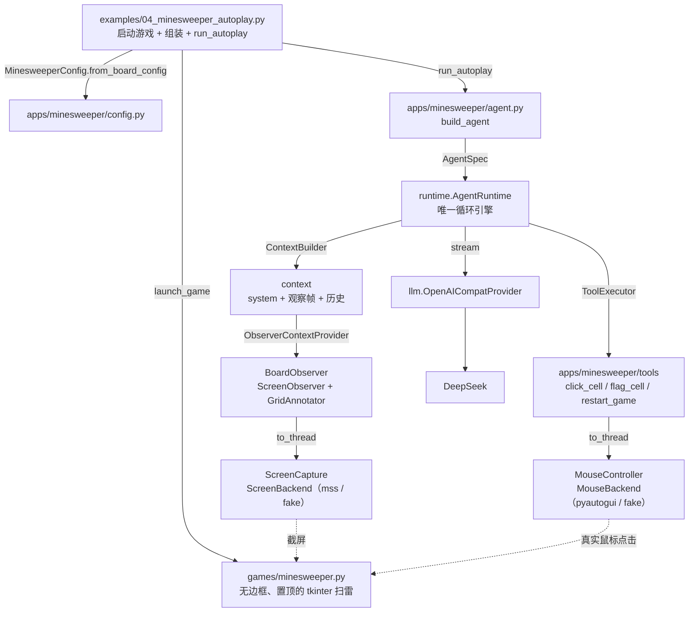
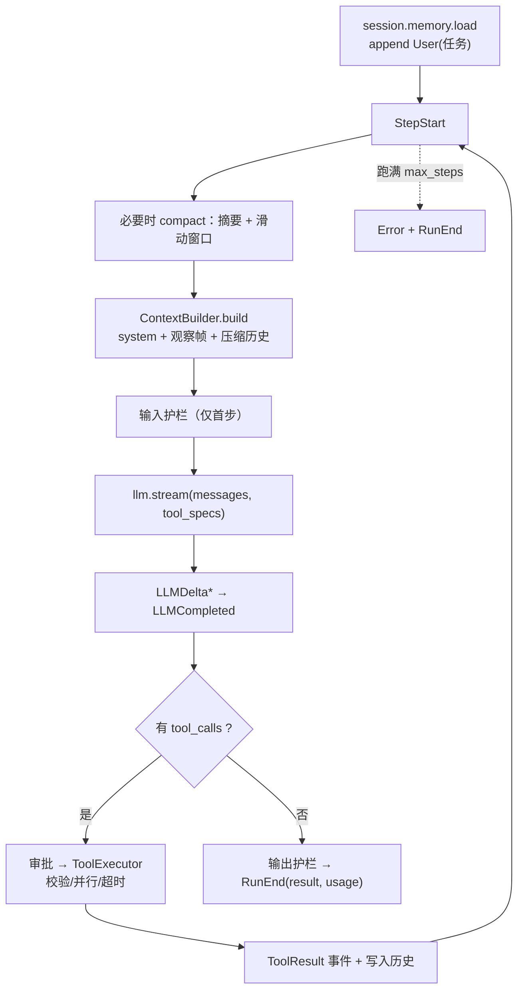
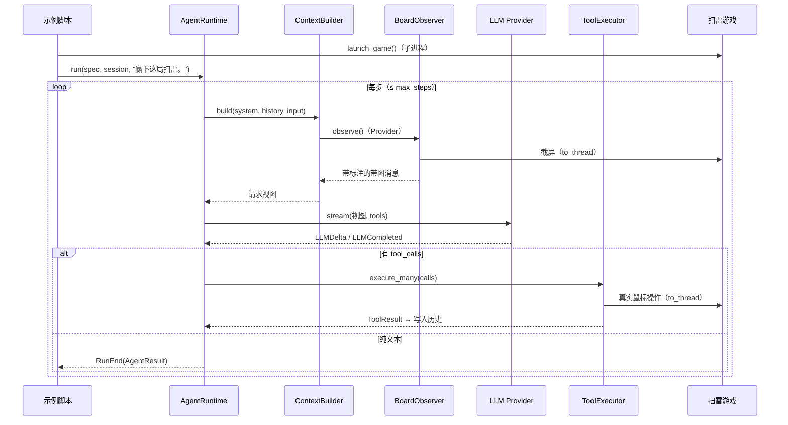

# 扫雷视觉 Agent 调用流程

> 梳理 `examples/04_minesweeper_autoplay.py` 从启动到结束的完整调用脉络。
> 每条链路都对应仓库里的实际源码。

## 1. 组件全景（谁调用谁）



纯文本版：

```text
examples/04_minesweeper_autoplay.py
  ① enable_dpi_awareness()
  ② config = MinesweeperConfig.from_board_config(board_config())
  ③ proc = launch_game()                     # 子进程启动目标扫雷
  ④ result = await run_autoplay(config, llm)
       └─ build_agent(config, llm)
            ├─ BoardObserver(capture, geometry)
            ├─ ToolRegistry(click_cell, flag_cell, restart_game)
            ├─ AgentSpec(system_prompt, tools, context_providers=[ObserverContextProvider])
            └─ AgentRuntime + InMemorySession
```

## 2. 主循环（`AgentRuntime.run`）



关键点：

- **观察帧不进历史**：`ObserverContextProvider` 在每轮装配时取一帧最新截图；
  历史里只保留文本进展，请求体不随轮数膨胀。
- **装配结果不落盘**：system prompt、观察帧、检索片段只存在于本次请求视图。
- **工具轮文本保留**：assistant 的 `content` 与 `tool_calls` 一起写入历史。
- **工具失败也落历史**：可恢复错误以 tool 消息回填，模型下一轮能看到真实结果。

## 3. 一轮的时序



## 4. 两条子链路：看 / 做

```text
【看】BoardObserver.observe() → ScreenObserver
  await asyncio.to_thread(ScreenCapture.grab)
      │ · ScreenBackend 抓取 region（默认 mss，测试注入 fake）
      │ · scale = 物理像素 / 逻辑点，首次探测并缓存
      ▼  PIL.Image（与鼠标坐标系 1:1）
  await asyncio.to_thread(GridAnnotator.draw)
      │ · 红色网格线 + 蓝色 1 基行列号
      ▼
  to_thread(下采样 + PNG 编码) → Message.user_with_image
      ▼
  交给 ContextBuilder，只进入本次请求视图

【做】ToolExecutor.execute_many
  click_cell(row,col) → BoardGeometry.cell_center → to_thread(MouseController.click)
  flag_cell(row,col)  → cell_center → to_thread(MouseController.shift_click)
  restart_game()      → 点重开按钮 / 按键（to_thread）
      ▼
  MouseBackend（默认 pyautogui，测试注入 fake）发事件 → 扫雷窗口响应
      ▼
  返回 "ok"；模型通过下一帧截图判断结果
```

## 5. 一次 LLM 请求的组装与落盘

```text
请求视图（不写回历史）：
  [System(扫雷提示词)]
  + [User(带网格的截图)]        ← ObserverContextProvider，每轮最新一帧
  + [压缩后的历史：assistant/tool 文本]

         tools = 3 个工具的 JSON Schema
                         │
                         ▼
              openai_compat.stream()
                         │
        ┌────────────────┼──────────────────────────┐
        ▼                                           ▼
写 log/llm.log（始终 DEBUG）                  POST /chat/completions
 · 请求 messages + tools 的 JSON                · 图片以 base64 data URL 内联
 · 内联图片抽出落盘 log/pic/*.png（同图去重）
                         │
                         ▼
              LLMDelta → LLMCompleted(ChatResult)
```

若 spec 配置了 `JSONLTracer`，所有运行事件还会写入 `log/trace.jsonl`。

## 6. 关键设计点

| 点 | 说明 |
|---|---|
| **框架与应用分离** | 截屏/鼠标/观察/标注在 `capabilities/computer_use`；棋盘几何、工具、提示词、启动在 `apps/minesweeper` |
| **观察帧不进历史** | 由 ContextProvider 每轮贡献一帧，历史只留文本 |
| **工具返回 `ok`** | 不回报坐标细节，让模型依据最新截图判断结果 |
| **插旗用 Shift+左键** | macOS 上 tkinter 收不到合成右键事件，只有左键能触发 |
| **坐标精确** | 1 基行列号 → `origin + (n-1)*cell + cell//2`；scale 归一化保证截图与鼠标坐标 1:1 |
| **不阻塞事件循环** | 截屏、标注、PNG 编码与鼠标操作都经 `asyncio.to_thread` |
| **e2e 可离线** | fake LLM + fake ScreenBackend/MouseBackend 覆盖观察、操作与结束 |

## 7. 对应源码

| 环节 | 文件 |
|---|---|
| 入口 / 启动 | `examples/04_minesweeper_autoplay.py`、`apps/minesweeper/launcher.py` |
| 目标游戏 | `games/minesweeper.py` |
| 主循环 | `src/agent_frame/runtime/runtime.py` |
| 请求装配 | `src/agent_frame/context/builder.py` |
| 应用组装 / 提示词 | `apps/minesweeper/agent.py`、`apps/minesweeper/prompt.py` |
| 配置 | `apps/minesweeper/config.py` |
| 观察者 | `apps/minesweeper/observer.py` |
| 截屏 / 鼠标 / 标注 | `src/agent_frame/capabilities/computer_use/{screen,mouse,annotate,observer}.py` |
| 坐标换算 | `apps/minesweeper/board.py` |
| 扫雷工具 | `apps/minesweeper/tools.py` |
| LLM 协议 / 日志 | `src/agent_frame/llm/openai_compat.py` |
| 图片落盘 | `src/agent_frame/core/images.py` |
| 事件 trace | `src/agent_frame/obs/tracer.py` |
